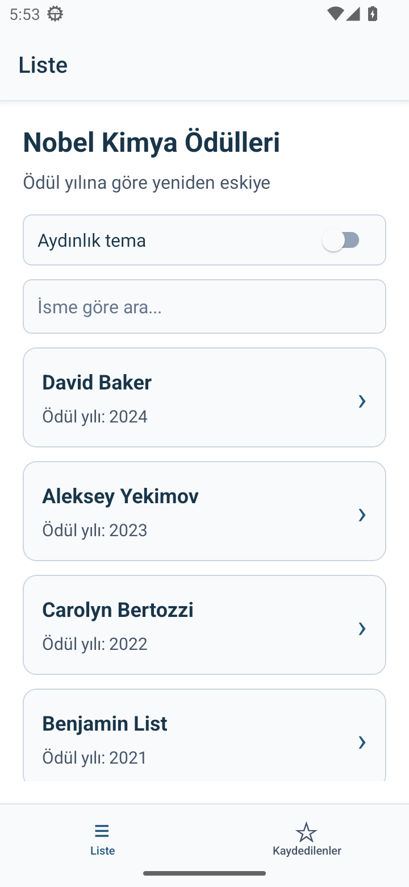
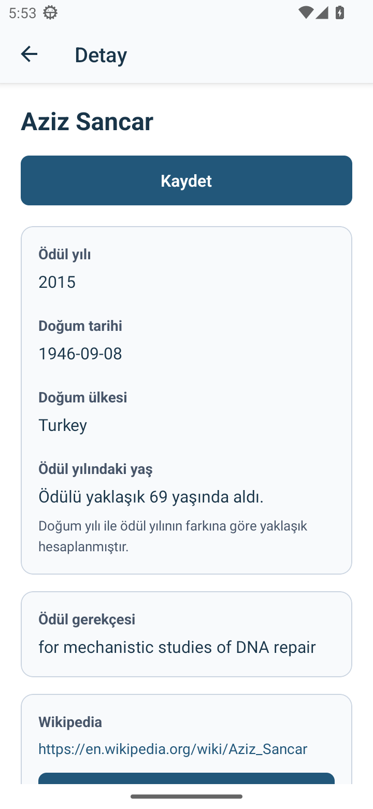
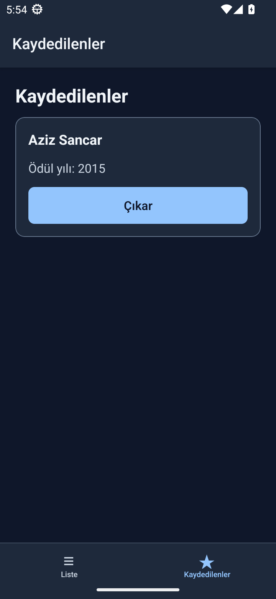

# Nobel Kimya Ödülleri

Sakarya Üniversitesi BSM447 Mobil Uygulama Geliştirme dersi dönem ödevi.

[GitHub kaynak deposu](https://github.com/khalidAlmuanen/bsm447-odev-G211210575)

- Öğrenci numarası: **G211210575**
- Konu: **K08 - Nobel Ödülleri**
- Varyant: **b - Kimya**
- Ek kural: **7 - Karanlık / Aydınlık Tema**
- Kalıcı veri yöntemi: **AsyncStorage 2.2.0**. Kaydedilen kayıtlar tüm detaylarıyla JSON olarak saklanır ve uygulama açıldığında geri yüklenir.

## Projenin mevcut durumu

Phase 1–6 uygulandı; Phase 7 için imzalı APK, Android emülatör testi, gerçek ekran görüntüleri ve ekran kaydı hazırlandı. Uygulamanın görünen adı **Nobel Kimya**. Fiziksel telefon testi ve OBİS teslimi öğrenci tarafından tamamlanmalıdır.

Çalışan özellikler:

- React Navigation ile Liste ve Kaydedilenler alt sekmeleri, bunların üzerinde açılan Detay ekranı.
- Nobel Prize API üzerinden uygulama çalışırken 30 Kimya ödülü sahibinin alınması.
- FlatList ile ad ve ödül yılı gösterimi; kayıt kimliğinin liste anahtarı olarak kullanılması.
- Gelen 30 kaydın ödül yılına göre yeniden eskiye sıralanması.
- İsimde büyük/küçük harfe duyarsız arama.
- Seçilen kaydın route.params ile Detay ekranına aktarılması; ad, ödül yılı, doğum tarihi, ülke ve ödül gerekçesinin gösterilmesi.
- Doğum yılı ile ödül yılının farkından yaklaşık yaş hesaplanması. Eksik ay/gün bilgileri açıkça belirtilir; bu değer ödül günündeki kesin yaş değildir.
- Mevcut İngilizce Wikipedia bağlantısının gösterilmesi ve açılması; açılamayan bağlantı için hata mesajı.
- Yükleniyor, boş sonuç ve hata mesajları; Tekrar dene düğmesi.
- Detay ekranında Kaydet / Kaydedilenlerden çıkar düğmesi; durum iki ekranda ortak tutulur.
- Kaydedilenler ekranında kayıtları listeleme, aynı Detay ekranına geçiş ve Çıkar düğmesi.
- Uygulama yeniden açıldığında kayıtları AsyncStorage'dan geri yükleme; API erişilemese de saklanan detayları gösterme.
- Depolama okuma/yazma hatalarını gösterme; okuma tamamlanmadan kayıtları değiştirmeme ve yazma başarısızsa mevcut listeyi koruma.
- Liste ekranında Karanlık / Aydınlık Tema anahtarı; üç ekran, arama alanı, düğmeler, başlıklar ve alt sekmeler için ortak renkler.
- Tema tercihini AsyncStorage'da kaydedilenlerden ayrı `@nobel-chemistry/tema/v1` anahtarında saklama ve açılışta geri yükleme. İlk kullanımda aydınlık tema seçilir.
- Tema okuması tamamlanmadan anahtarı kilitleme; okuma hatasında Temayı tekrar yükle düğmesi. Yazma hatasında önceki temayı koruma ve hata mesajı gösterme.
- İki temada kart düzeni, güvenli ekran kenarları, en az 48 birim yüksekliğinde düğmeler ve açıklayıcı erişilebilirlik etiketleri.
- API yanıtında geçersiz kayıtları eleme; eksik/bozuk metin ve yıl alanlarında güvenli yedek metinler. 20 saniyelik bağlantı zaman aşımı için ayrı mesaj ve yeniden deneme.
- Kaydedilenler boşken simge ve nasıl kayıt ekleneceğini açıklayan metin.
- Kimya şişesi çizimli özel uygulama simgesi; PNG dosyaları ve düzenlenebilir `assets/icon-source.svg` çizim kaynağı.

## Veri kaynağı

[Nobel Prize API - Kimya](https://api.nobelprize.org/2.1/laureates?limit=30&nobelPrizeCategory=che)

Veriler API yanıtındaki laureates dizisinden okunur. Projeye kopyalanmış bir JSON veri seti kullanılmaz. Belirlenen adresin döndürdüğü ilk 30 kayıt sıralanır; tüm kazananlar veya en yeni 30 kazanan listeleniyor iddiası yoktur.

## Kullanılan teknolojiler

- JavaScript, React Native ve Expo SDK 58 (expo ~58.0.26)
- React Navigation: Bottom Tabs ve Native Stack
- AsyncStorage ile kalıcı veri; App.js içindeki ortak state ve ekranlara geçirilen props
- useState, useEffect, fetch, FlatList, TextInput ve StyleSheet.create

## Kurulum ve çalıştırma

Node.js ve Expo SDK 58 ile uyumlu Expo Go gerekir. Depo klasöründe:

```sh
npm ci
npx expo start
```

Android telefonda Expo Go ile terminaldeki QR kodunu okutun. Telefon ve bilgisayar aynı Wi-Fi ağında olmalıdır.

Listeyi ve yıl sırasını kontrol edin. aziz ve AZIZ ile arama yapın; Aziz Sancar'ın detayında 2015 ödül yılı, 1946-09-08 doğum tarihi ve yaklaşık 69 yaş bilgisini kontrol edin. David Baker'ın eksik doğum tarihi 1962 (ay ve gün bilinmiyor), yaklaşık yaşı 62 olarak gösterilir. Wikipedia düğmesini ve geri dönüşü deneyin. Fiziksel Android telefon testi henüz doğrulanmadı.

Kaydet düğmesine basın; düğme Kaydedilenlerden çıkar olarak değişmelidir. Kaydedilenler sekmesinde aynı kaydı açın, çıkarın ve diğer ekrandaki durumunu kontrol edin. İki kayıt ekleyip uygulamayı tamamen kapatın ve uygulama verilerini silmeden yeniden açın. Kayıtların ve detaylarının kaldığını, çıkarılan kaydın tekrar açılışta gelmediğini doğrulayın. API erişilemediğinde Kaydedilenler'i deneyin; Expo Go geliştirme testinde Metro sunucusuna yerel erişim sürmelidir.

Liste ekranındaki tema anahtarını açın. Detay ve Kaydedilenler'e geçerek yazıların, arama alanının, düğmelerin, başlıkların ve alt sekmelerin karanlık temada okunabildiğini kontrol edin. Uygulamayı tamamen kapatıp verilerini silmeden yeniden açın; karanlık tema ve kayıtlar korunmalıdır. Anahtarı kapatarak aydınlık tema için aynı adımları tekrarlayın. Telefonda klavye, durum çubuğu ve Android geri düğmesini de deneyin.

Küçük ekran ve büyük yazı boyutunda kartları, uzun adları ve Detay ekranının kaydırılmasını kontrol edin. API erişimini geçici olarak kesip hata mesajı ve Tekrar dene düğmesini deneyin; Metro erişimi sürmelidir. Android başlatıcısındaki uygulama simgesinin kontrolü APK aşamasında yapılacaktır.

Doğum tarihi, yaklaşık yaş, kaydedilen veri, eksik/bozuk API alanlarının gösterimi ve tema tercihi doğrulamasının; ayrıca metin renklerinin kontrastının otomatik testlerini çalıştırmak için:

```sh
npm test
```

## Doğrulama

- 27 Kasım 2026: `npm test` **105/105** başarılı. Git arşivinden ayrı klasöre çıkarılan kaynakta `npm ci` ve aynı **105/105** test de başarılı.
- 27 Kasım: EAS `preview` APK derlemesi başarılı; arşiv bütünlüğü, paket/sürüm bilgileri ve APK v2 imzası doğrulandı.
- Android 13 / API 33, x86_64 emülatörde gerçek APK kuruldu ve çalıştırıldı. Canlı liste ve yıl sırası, `AZIZ` araması, Aziz Sancar'ın detayları ve yaklaşık 69 yaşı, kaydetme, çıkarma, boş kayıt listesi, sistem geri düğmesi ve iki tema kontrol edildi. Kayıtların, silmenin ve her iki tema seçiminin uygulama durdurulup yeniden açıldığında korunduğu doğrulandı.
- Emülatörün Wi-Fi ve mobil verisi kapatılıp uygulama yeniden açıldı: API hata mesajı görülürken iki kayıt ve Aziz Sancar'ın tam detayları Kaydedilenler'den açıldı. Bağlantı geri getirildikten sonra Tekrar dene canlı listeyi yeniden yükledi.
- İlk klavye açılışında ANR görüldü; Android raporunda yüksek bellek baskısı vardı. Sonraki tekrar testleri geçti. Fiziksel telefon performansı ve büyük yazı boyutu kontrolü bekliyor.
- 27 Kasım: `expo-doctor` **18/20**. Expo config schema kontrolü bağlantı hatasıyla tamamlanamadı; diğer uyarı önerilen Expo `~58.1.0` ile kurulu `58.0.26` farkıydı. SDK/bağımlılıklar değiştirilmedi; mevcut sürümle APK derlendi ve emülatörde test edildi.
- 25 Kasım: Geçici JSDOM ortamında gerçek Metro web paketiyle **20/20** çalışma kontrolü başarılıydı: API, gezinme, arama, temalar, kalıcılık, HTTP/JSON/yanıt hataları, boş liste, eksik alanlar ve depolama hataları. Bu kontrollerde depolama/hata senaryoları simüle edildi; zaman aşımı hızlandırıldı.

## Tamamlanacak işler

- Fiziksel Android telefonda klavye, performans, büyük yazı boyutu ve başlatıcı simgesi kontrolü.
- En az 10 gerçek farklı günde anlamlı Git çalışması şartını tamamlama; tarihler değiştirilmez.
- OBİS'e ZIP yükleme ve başarılı teslimi kişisel olarak doğrulama.
- Phase 8: canlı sınav görevlerine ayrı çalışma kopyasında hazırlanma.

## Ekran görüntüleri

27 Kasım 2026'da Android 13 emülatörde, aşağıda bağlantısı verilen gerçek APK'dan alındı. Kaydedilenler görüntüsü karanlık temadadır.





## APK indirme bağlantısı

[Nobel Kimya 1.0.0 APK indir](https://expo.dev/artifacts/eas/-T7817AdA-wSITDPi0DvzWWYl6-ZtshGEQx8hCqFG1o.apk)

[EAS build ayrıntıları](https://expo.dev/accounts/khalid_almuanen/projects/nobel-chemistry/builds/4e0402c9-d387-4754-bc9e-804a9c20ea90)

- Profil: `preview`, sürüm: `1.0.0`, `versionCode: 1`.
- Uygulama ve yapılandırma commit'i: `7bda615`.
- Boyut: 76.883.157 bayt; APK ZIP bütünlüğü ve v2 imzası doğrulandı.
- SHA-256: `c5678637f6e0fbdce9f678c0adc2db498faa8696abb8bf6f37ff39908e8ff3c0`.

## APK üretimi

`eas.json` içindeki `preview`, `distribution: internal` ve `android.buildType: apk` kullanır. Android uygulama kimliği `com.khalidalmuanen.nobelchemistry`, sürüm kodu `1`'dir. Proje EAS üzerinde `@khalid_almuanen/nobel-chemistry` hesabına bağlıdır. Anahtar ve parolalar depoda tutulmaz; imzalama EAS tarafından yönetilir.

Yetkili Expo hesabıyla:

```sh
npx eas-cli@27.11.0 login
npx eas-cli@27.11.0 build -p android --profile preview
```

APK, Expo Go yerine ayrı bir uygulama olarak kurulur. Yapılandırma için [Expo APK rehberi](https://docs.expo.dev/build-reference/apk/) kullanılabilir. `.easignore`, yerel notları, ödev PDF'sini, bağımlılıkları, sırları ve GitHub'daki dokümantasyon medyasını derleme arşivinden çıkarır.

## Ekran kaydı

[Gerçek APK ekran kaydını izle / indir](https://github.com/khalidAlmuanen/bsm447-odev-G211210575/raw/refs/heads/master/docs/ekran-kaydi.mp4)

Yaklaşık **47 saniye**, 720×1560; Android 13 emülatörden doğrudan alındı. Liste, David Baker'ın detayları, Kaydet, Kaydedilenler ve karanlık temaya geçiş gösterilir. Uygulamanın gerçek çalışması kaydedildi.

## Teslim

Teslim dosyası: G211210575_BSM447.zip. node_modules ve .expo klasörleri ZIP'e eklenmez. Son teslim 15 Aralık 2026, saat 23.59; ZIP dosyası OBİS'e yüklenmelidir.

Git'e alınmış son sürümden ZIP'i yeniden üretmek için:

```sh
git archive --format=zip --output=G211210575_BSM447.zip HEAD
```

Bu komut yalnızca seçilen commit'in dosyalarını ekler; `.git`, `node_modules`, `.expo` ve yerel checklist/PDF arşive girmez. ZIP'i açıp `npm ci` ve `npm test` ile kontrol edin. OBİS yüklemesini öğrenci kendisi yapmalı ve başarılı teslimi doğrulamalıdır.

## Lisans bildirimi

LICENSE dosyasında Expo / 650 Industries kaynaklı MIT lisans bildirimi korunmaktadır. Kullanılan bağımlılıkların kendi lisansları da geçerlidir.
